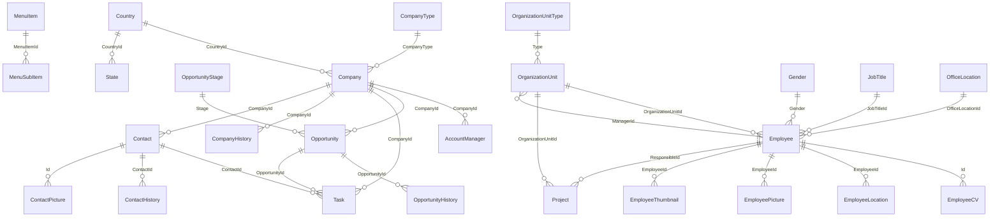

# 02 — Data model

Source: `getSerializedObject › Entities`. `*` = mandatory, `→` = foreign key (delete rule).

| Entity | Module | Kind | Description / label | Attributes |
|---|---|---|---|---|
| **AccountManager** | Sales | server | Account Manager | 2 |
| **MenuItem** | Sales | static | Menu Item | 3 |
| **MenuSubItem** | Sales | static | Menu Sub Item | 4 |
| **Opportunity** | Sales | server | Opportunity | 9 |
| **OpportunityHistory** | Sales | server | Opportunity History | 5 |
| **OpportunityStage** | Sales | static | Opportunity Stage | 5 |
| **QuarterQuota** | Sales | server | Quarter Quota | 2 |
| **Task** | Sales | server | Task | 8 |
| **Company** | Customers | server | Company | 11 |
| **CompanyHistory** | Customers | server | Company History | 5 |
| **CompanyType** | Customers | static | Company Type | 3 |
| **Contact** | Customers | server | Contact | 8 |
| **ContactHistory** | Customers | server | Contact History | 5 |
| **ContactPicture** | Customers | server | Contact Picture | 4 |
| **Country** | Customers | static | Country | 4 |
| **State** | Customers | static | State | 4 |
| **Employee** | Employees | server | Employee | 20 |
| **EmployeeCV** | Employees | server | Employee CV | 4 |
| **EmployeeLocation** | Employees | server | Employee Location | 7 |
| **EmployeePicture** | Employees | server | Employee Picture | 5 |
| **EmployeeThumbnail** | Employees | server | Employee Thumbnail | 5 |
| **Gender** | Employees | static | Gender | 4 |
| **JobTitle** | Employees | server | Job Title | 3 |
| **OfficeLocation** | Employees | server | Office Location | 8 |
| **OrganizationUnit** | Employees | server | Organization Unit | 8 |
| **OrganizationUnitType** | Employees | static | Organization Unit Type | 3 |
| **Project** | Employees | server | Project | 11 |

## AccountManager
IdentifierAttribute: `CompanyId` · Public: `True`

| Attribute | Type | Rules | Description |
|---|---|---|---|
| CompanyId | → Company (Delete) | * |  |
| UserId | → User (Protect) |  |  |

## MenuItem
IdentifierAttribute: `Id` · Public: `True`

| Attribute | Type | Rules | Description |
|---|---|---|---|
| Id | Integer | * auto |  |
| Order | Integer | * |  |
| Caption | Text(50) | * |  |

**Records (9):** Companies, Contacts, Dashboard, More, MyCompanies, MyContacts, MyDetails, MyOpportunities, Opportunities

## MenuSubItem
IdentifierAttribute: `Id` · LabelAttribute: `Caption` · Public: `True`

| Attribute | Type | Rules | Description |
|---|---|---|---|
| Id | Integer | * auto |  |
| Order | Integer | * |  |
| Caption | Text(50) | * |  |
| MenuItemId | → MenuItem |  |  |

**Records (4):** ClosedOpportunities, History, ImportYourOwnData, QuarterQuotas

## Opportunity
IdentifierAttribute: `Id` · LabelAttribute: `Name` · Public: `True`

| Attribute | Type | Rules | Description |
|---|---|---|---|
| Id | Integer | * auto |  |
| CompanyId | → Company (Protect) | * |  |
| Name | Text(50) | * |  |
| Description | Text(500) |  |  |
| CloseDate | Date |  |  |
| Amount | Currency |  |  |
| Stage | → OpportunityStage (Protect) | * |  |
| LastModified | Date Time |  |  |
| Proposal | Binary Data |  |  |

## OpportunityHistory
IdentifierAttribute: `Id` · Public: `True`

| Attribute | Type | Rules | Description |
|---|---|---|---|
| Id | Integer | * auto |  |
| OpportunityId | → Opportunity (Ignore) |  |  |
| UserId | → User (Ignore) |  |  |
| Instant | Date Time |  |  |
| Description | Text(500) |  |  |

## OpportunityStage
IdentifierAttribute: `Id` · LabelAttribute: `Label` · Public: `True`

| Attribute | Type | Rules | Description |
|---|---|---|---|
| Id | Integer | * auto |  |
| Label | Text(50) | * |  |
| Order | Integer | * |  |
| Percentage | Decimal |  |  |
| ChartColor | Text(50) |  |  |

**Records (8):** Finalizing_90, Lead_10, Lost, Meeting_40, Negotiating_80, Opportunity_20, Validating_70, Won

## QuarterQuota
IdentifierAttribute: `UserId` · Public: `True`

| Attribute | Type | Rules | Description |
|---|---|---|---|
| UserId | → User (Protect) | * |  |
| QuarterQuota | Currency |  |  |

## Task
IdentifierAttribute: `Id` · Public: `True`

| Attribute | Type | Rules | Description |
|---|---|---|---|
| Id | Integer | * auto |  |
| Name | Text(150) | * |  |
| UserId | → User (Delete) | * |  |
| DueDate | Date | * |  |
| CompanyId | → Company (Protect) |  |  |
| OpportunityId | → Opportunity (Protect) |  |  |
| ContactId | → Contact (Protect) |  |  |
| IsCompleted | Boolean |  |  |

## Company
IdentifierAttribute: `Id` · LabelAttribute: `CompanyName` · Public: `True`

| Attribute | Type | Rules | Description |
|---|---|---|---|
| Id | Integer | * auto |  |
| CompanyName | Text(50) | * |  |
| CompanyType | → CompanyType (Protect) |  |  |
| Phone | Phone Number |  |  |
| Email | Text(50) |  |  |
| Fax | Phone Number |  |  |
| Website | Text(50) |  |  |
| Address | Text(50) |  |  |
| PostalCode | Text(50) |  |  |
| City | Text(50) |  |  |
| CountryId | → Country (Protect) |  |  |

**Unique indexes:** CompanyName (CompanyName)

## CompanyHistory
IdentifierAttribute: `Id` · Public: `True`

| Attribute | Type | Rules | Description |
|---|---|---|---|
| Id | Integer | * auto |  |
| CompanyId | → Company (Ignore) |  |  |
| UserId | → User (Ignore) |  |  |
| Instant | Date Time | * |  |
| Description | Text(500) |  |  |

## CompanyType
IdentifierAttribute: `Id` · LabelAttribute: `Label` · Public: `True`

| Attribute | Type | Rules | Description |
|---|---|---|---|
| Id | Integer | * auto |  |
| Label | Text(50) | * |  |
| Order | Integer | * |  |

**Records (2):** Customer, Prospect

## Contact
IdentifierAttribute: `Id` · LabelAttribute: `Name` · Public: `True`

| Attribute | Type | Rules | Description |
|---|---|---|---|
| Id | Integer | * auto |  |
| Name | Text(100) | * |  |
| JobTitle | Text(50) |  |  |
| Phone | Phone Number |  |  |
| Mobile | Phone Number |  |  |
| Email | Text(250) |  |  |
| CompanyId | → Company (Protect) |  |  |
| SecondaryEmail | Text(250) |  |  |

## ContactHistory
IdentifierAttribute: `Id` · Public: `True`

| Attribute | Type | Rules | Description |
|---|---|---|---|
| Id | Integer | * auto |  |
| ContactId | → Contact (Ignore) |  |  |
| UserId | → User (Ignore) |  |  |
| Instant | Date Time | * |  |
| Description | Text(500) |  |  |

## ContactPicture
IdentifierAttribute: `Id` · Public: `True`

| Attribute | Type | Rules | Description |
|---|---|---|---|
| Id | → Contact (Delete) | * |  |
| Picture | Binary Data |  |  |
| Filename | Text(50) |  |  |
| Filetype | Text(50) |  |  |

## Country
IdentifierAttribute: `Id` · LabelAttribute: `Name` · Public: `True`

| Attribute | Type | Rules | Description |
|---|---|---|---|
| Id | Integer | * auto |  |
| Name | Text(100) | * |  |
| Code | Text(50) |  |  |
| HasStates | Boolean |  |  |

**Records (202):** Afghanistan, Albania, Algeria, Andorra, Angola, Anguilla, Antarctica, AntiguaBarbuda, Argentina, Armenia, Australia, Austria, Azerbaijan, Bahama, Bahrain, Bangladesh, Barbados, Belarus, Belgium, Belize, Benin, Bhutan, Bolivia, BosniaandHerzegovina, Botswana, Brazil, BruneiDarussalam, Bulgaria, BurkinaFaso, Burundi, Cambodia, Cameroon, Canada, CapeVerde, CentralAfricanRepublic, Chad, Chile, China, Colombia, Comoros, Congo, CostaRica, CoteD_ivoire_IvoryCoast_, Croatia, Cuba, Cyprus, CzechRepublic, Denmark, Djibouti, Dominica, DominicanRepublic, EastTimor, Ecuador, Egypt, ElSalvador, EquatorialGuinea, Eritrea, Estonia, Ethiopia, Fiji, Finland, France, France_Metropolitan, FrenchGuiana, FrenchPolynesia, Gabon, Gambia, Georgia, Germany, Ghana, Greece, Greenland, Grenada, Guatemala, Guinea, GuineaBissau, Guyana, Haiti, Honduras, HongKong, Hungary, Iceland, India, Indonesia, Iraq, Ireland, IslamicRepublicofIran, Israel, Italy, Jamaica, Japan, Jordan, Kazakhstan, Kenya, Kiribati, Korea_DemocraticPeople_sRepublicof, Korea_Republicof, Kuwait, Kyrgyzstan, LaoPeople_sDemocraticRepublic, Latvia, Lebanon, Lesotho, Liberia, LibyanArabJamahiriya, Liechtenstein, Lithuania, Luxembourg, Macau, Madagascar, Malawi, Malaysia, Maldives, Mali, Malta, MarshallIslands, Mauritania, Mauritius, Mexico, Moldova_Republicof, Monaco, Mongolia, Morocco, Mozambique, Myanmar, Namibia, Nauru, Nepal, Netherlands, NewCaledonia, NewZealand, Nicaragua, Niger, Nigeria, Norway, Oman, Pakistan, Palau, Panama, PapuaNewGuinea, Paraguay, Peru, Philippines, Poland, Portugal, PuertoRico, Qatar, Reunion, Romania, RussianFederation, Rwanda, SaintLucia, Samoa, SanMarino, SaoTomePrincipe, SaudiArabia, Senegal, Seychelles, SierraLeone, Singapore, Slovakia, Slovenia, SolomonIslands, Somalia, SouthAfrica, Spain, SriLanka, St_KittsandNevis, St_VincenttheGrenadines, Sudan, Suriname, Swaziland, Sweden, Switzerland, SyrianArabRepublic, Taiwan_ProvinceofChina, Tajikistan, Tanzania_UnitedRepublicof, Thailand, Togo, Tonga, TrinidadTobago, Tunisia, Turkey, Turkmenistan, Tuvalu, Uganda, Ukraine, UnitedArabEmirates, UnitedKingdom_GreatBritain_, UnitedStatesofAmerica, Uruguay, Uzbekistan, Vanuatu, VaticanCityState_HolySee_, Venezuela, VietNam, WesternSahara, Yemen, Zaire, Zambia, Zimbabwe

## State
IdentifierAttribute: `Id` · LabelAttribute: `Name` · Public: `True`

| Attribute | Type | Rules | Description |
|---|---|---|---|
| Id | Integer | * auto |  |
| Name | Text(100) | * |  |
| Code | Text(50) | * |  |
| CountryId | → Country |  |  |

**Records (51):** Alabama, Alaska, Arizona, Arkansas, California, Colorado, Connecticut, Delaware, DistrictofColumbia, Florida, Georgia, Hawaii, Idaho, Illinois, Indiana, Iowa, Kansas, Kentucky, Louisiana, Maine, Maryland, Massachusetts, Michigan, Minnesota, Mississippi, Missouri, Montana, Nebraska, Nevada, NewHampshire, NewJersey, NewMexico, NewYork, NorthCarolina, NorthDakota, Ohio, Oklahoma, Oregon, Pennsylvania, RhodeIsland, SouthCarolina, SouthDakota, Tennessee, Texas, Utah, Vermont, Virginia, Washington, WestVirginia, Wisconsin, Wyoming

## Employee
IdentifierAttribute: `UserId` · Public: `True`

| Attribute | Type | Rules | Description |
|---|---|---|---|
| UserId | → User (Protect) | * |  |
| OrganizationUnitId | → OrganizationUnit (Protect) | * |  |
| ReportsToId | → Employee (Protect) |  |  |
| Birthday | Date |  |  |
| Gender | → Gender (Protect) |  |  |
| Address | Text(100) |  |  |
| JobTitleId | → JobTitle (Protect) |  |  |
| OfficeLocationId | → OfficeLocation (Protect) |  |  |
| EmployeeCode | Text(50) |  |  |
| Extension | Text(50) |  |  |
| SkypeUsername | Text(50) |  |  |
| IMUsername | Text(50) |  |  |
| LinkedInUrl | Text(250) |  |  |
| EntryDate | Date |  |  |
| CreatedOn | Date |  |  |
| CreatedBy | → User (Protect) |  |  |
| EndedOn | Date |  |  |
| EndedBy | → User (Protect) |  |  |
| UpdatedOn | Date Time |  |  |
| IsExternal | Boolean |  |  |

## EmployeeCV
IdentifierAttribute: `Id` · Public: `True`

| Attribute | Type | Rules | Description |
|---|---|---|---|
| Id | → Employee (Delete) | * |  |
| File | Binary Data |  |  |
| Filename | Text(256) |  |  |
| Filetype | Text(256) |  |  |

## EmployeeLocation
IdentifierAttribute: `EmployeeId` · Public: `True`

| Attribute | Type | Rules | Description |
|---|---|---|---|
| EmployeeId | → Employee (Delete) | * |  |
| Address | Text(250) | * |  |
| Latitude | Text(50) |  |  |
| Longitude | Text(50) |  |  |
| RetrievedDateTime | Date Time | * |  |
| TimezoneInfoId | → TimezoneInfo (Delete) |  |  |
| UpdatedOn | Date Time |  |  |

## EmployeePicture
IdentifierAttribute: `EmployeeId` · Public: `True`

| Attribute | Type | Rules | Description |
|---|---|---|---|
| EmployeeId | → Employee (Delete) | * |  |
| Picture | Binary Data |  |  |
| Filename | Text(50) |  |  |
| Filetype | Text(50) |  |  |
| UpdatedOn | Date Time |  |  |

## EmployeeThumbnail
IdentifierAttribute: `EmployeeId` · Public: `True`

| Attribute | Type | Rules | Description |
|---|---|---|---|
| EmployeeId | → Employee (Delete) | * |  |
| Thumbnail | Binary Data |  |  |
| Filename | Text(50) |  |  |
| Filetype | Text(50) |  |  |
| UpdatedOn | Date Time |  |  |

## Gender
IdentifierAttribute: `Id` · LabelAttribute: `Label` · IsActiveAttribute: `Is_Active` · Public: `True`

| Attribute | Type | Rules | Description |
|---|---|---|---|
| Id | Integer | * auto |  |
| Label | Text(50) | * |  |
| Order | Integer | * |  |
| Is_Active | Boolean | * |  |

**Records (2):** Female, Male

## JobTitle
IdentifierAttribute: `Id` · Public: `True`

| Attribute | Type | Rules | Description |
|---|---|---|---|
| Id | Integer | * auto |  |
| Name | Text(50) | * |  |
| UpdatedOn | Date Time | * |  |

## OfficeLocation
IdentifierAttribute: `Id` · Public: `True`

| Attribute | Type | Rules | Description |
|---|---|---|---|
| Id | Integer | * auto |  |
| Name | Text(50) | * |  |
| Address | Text(50) | * |  |
| PhoneNumber | Phone Number |  |  |
| CountryStateId | → CountryState (Delete) | * |  |
| TimezoneInfoId | → TimezoneInfo (Delete) |  |  |
| LocationId | → Location (Ignore) |  |  |
| UpdatedOn | Date Time |  |  |

## OrganizationUnit
IdentifierAttribute: `Id` · Public: `True`

| Attribute | Type | Rules | Description |
|---|---|---|---|
| Id | Integer | * auto |  |
| Type | → OrganizationUnitType (Protect) |  |  |
| Name | Text(50) | * |  |
| ManagerId | → Employee (Protect) |  |  |
| ParentOrgUnitId | → OrganizationUnit (Protect) |  |  |
| HierarchicalName | Text(200) |  |  |
| Level | Integer |  |  |
| UpdatedOn | Date Time |  |  |

## OrganizationUnitType
IdentifierAttribute: `Id` · LabelAttribute: `Label` · Public: `True`

| Attribute | Type | Rules | Description |
|---|---|---|---|
| Id | Integer | * auto |  |
| Label | Text(50) | * |  |
| Order | Integer | * |  |

**Records (2):** Department, DepartmentUnit

## Project
IdentifierAttribute: `Id` · Public: `True`

| Attribute | Type | Rules | Description |
|---|---|---|---|
| Id | Integer | * auto |  |
| Name | Text(150) | * |  |
| Code | Text(20) |  |  |
| Description | Text(500) |  |  |
| OrganizationUnitId | → OrganizationUnit (Protect) |  |  |
| ResponsibleId | → Employee (Protect) |  |  |
| StartDate | Date |  |  |
| EndDate | Date |  |  |
| EstimateDays | Decimal |  |  |
| IsClosed | Boolean |  |  |
| IsActive | Boolean | default True |  |
